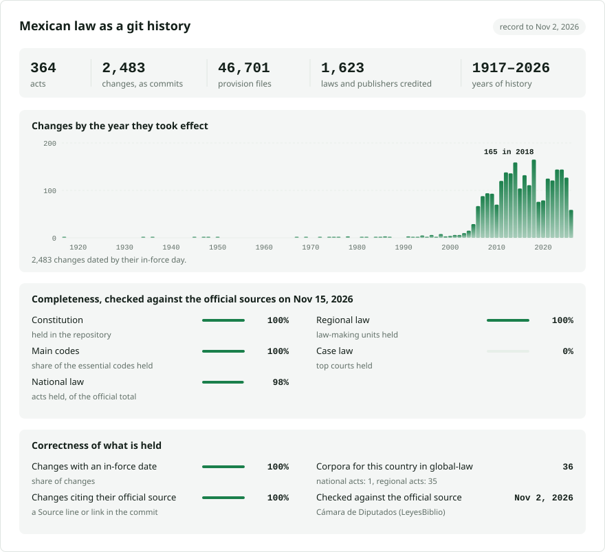

# Mexico: law history in git

[Español](README.md) · **English**

<picture>
<source media="(prefers-color-scheme: dark)" srcset="data/effort-dark.svg">

</picture>

The federal law of Mexico as a git history: one file per provision, one commit per decree on the day it took effect, and the decree that made each change as the commit's author. `git blame` names the decree behind every paragraph; `git log` lists every change to an article; picking a date gives the text in force that day.

Part of [lexifina/global-law](https://github.com/lexifina/global-law), one git history for every country's law: this is Mexico's federal law, which global-law reads at `mexico/national/acts/`.

**What is in it now:** 364 federal acts with 2,586 versions: the Constitution (117 versions, from the text in force on 8 April 2006 to the reform of 7 October 2026), 10 codes and 348 laws, among them the Código Civil Federal, the Código Penal Federal, the Ley Federal del Trabajo and the Ley de Amparo, the rules of procedure of Congress and of each of its chambers, the Estatuto de Gobierno del Distrito Federal and the Ordenanza General de la Armada. 56 of the codes and laws have since been abrogated, or expired at the end of their own term, and their history ends with a commit that removes every provision. [`data/versions.json`](data/versions.json) lists every act with the day each version took effect and the copy it was read from; [`data/laws.csv`](data/laws.csv) lists every decree, ruling, erratum and other publication the record names, with its dates.

Each act is a folder `<kind>/<year>/<name>/` (`ley/1970/ley-federal-del-trabajo/` is the Ley Federal del Trabajo, the Labour Law), with one file per article (`art-0076.md` is artículo 76, on annual leave), one per decree's transitorios (`transitorios-<DOF date>.md`) and a `README.md` that lists every provision and when it changed. Until 11 November 2026 each folder was named by the act's id alone (`ley-federal-del-trabajo/`), and the 56 closed acts keep that name; [`data/paths.json`](data/paths.json) maps each id to its folder. `git blame` and `git log --follow` follow the move; `git log` for a whole act names both folders.

The text is in Spanish, as the Cámara de Diputados consolidates it, one paragraph per line, with the Cámara's notes left out. An English translation is not part of this record.

## Questions as git commands

| Question | Command |
| --- | --- |
| Every change to art. 76 of the Ley Federal del Trabajo | `git log --follow -p --word-diff -- ley/1970/ley-federal-del-trabajo/art-0076.md` |
| Which decree wrote each paragraph of art. 76? | `git blame ley/1970/ley-federal-del-trabajo/art-0076.md` |
| Every version of the Ley Federal del Trabajo, with the day each took effect | `git log --format="%h %(trailers:key=In-force,valueonly,separator=) %an" -- ley/1970/ley-federal-del-trabajo ley-federal-del-trabajo ":^*README.md"` |
| Art. 76 as in force on 31 December 2022, the day before its reform | `python tools/en_vigor_el.py 2022-12-31 ley/1970/ley-federal-del-trabajo 76` |

**Outside git**, we also host this record publicly, for free:

- **[Ask Claude about Mexican law](https://global-law.lexifina.com/v1/try_claude?country=mexico)**: opens Claude with a first question ready.
- **[Ask ChatGPT](https://global-law.lexifina.com/v1/try_chatgpt?country=mexico)**: the same question in ChatGPT.
- **[Search Mexican law on our site](https://lexifina.com/law?country=mexico&q=vacaciones)**: a search for "vacaciones", with each provision's text and its versions, no account needed.
- **[Developer REST API](https://global-law.lexifina.com/v1/search_law?query=vacaciones&jurisdiction=mexico)**: the same search as JSON, with no key. See the [documentation here](https://lexifina.com/api/global-law).

Both assistants read the record through the free Global law connector (MCP, `https://global-law.lexifina.com/mcp`); the first time, the chat gives you the link that adds it. Ask in Spanish or in English.

**Host it yourself easily.** All it takes is git and Python, and the tools run on your machine:

```sh
git clone --depth 1 https://github.com/lexifina/global-law && cd global-law
python3 tools/countries.py add mexico/national/acts
python3 tools/law.py show 2026-01-01 mexico/national/acts/ley/1970/ley-federal-del-trabajo/art-0076.md
```

Opened in Claude Code, Cursor, VS Code or Codex, the clone also starts a local MCP server with the same tools ([MCP.md](https://github.com/lexifina/global-law/blob/main/MCP.md)).

## Dates

Each commit is dated at noon, America/Mexico_City, on the day the change took effect, and carries it in its `In-force:` trailer, beside `Published:`, the day of the Diario Oficial de la Federación (DOF):

- the day is read from each decree's own transitorios: "al día siguiente de su publicación" is the day after publication, a fixed date is used as given, and terms in business days, months or fiscal years were read decree by decree (each listed in `REPRODUCE.md`). Where no transitorio can be read, Código Civil Federal art. 3 applies: three days after publication;
- a decree that puts single provisions in force later changes the whole article on its general day, and the later dates stay in its transitorios file; the one exception is the labour-subcontracting decree of 23 April 2021, whose tax and public-service articles take their own days;
- git cannot store dates before 1970, so the 10 earlier commits (the first is the Ley sobre Delitos de Imprenta, in force 15 April 1917) are dated from 1970-01-01, one second apart, with the real day in `In-force:`. Ask for a date with `tools/en_vigor_el.py`, not `git log --before`.

Each change is credited to the decree that made it, with an address that cannot exist (`Decreto (DOF 27-12-2022) <decreto-dof-2022-12-27@diputados.invalid>`), only when one of the Cámara's notes on the paragraph ("Párrafo reformado DOF ...") gives that decree's date. Supreme Court rulings that strike provisions (40 commits), errata and the Acuerdos that update amounts are commits of their own. A first version that is not the act as enacted ("oldest version available", 140 acts) and the 563 changes no note explains are credited to the publisher, `Cámara de Diputados (LeyesBiblio)`; the committer is Lexifina.

## How it is checked

- `tools/check_repo.py` reads every version back from git on the day it took effect and on the day before; both must match the corpus, whose sha256 is in `data/corpus.sha256`: 2,586 versions of 364 acts, 0 mismatches ([`REPRODUCE.md`](REPRODUCE.md)).
- Each act's last version equals the Cámara's newest consolidated copy available; for 362 acts that copy, read a second way (plain text, notes removed), also contains every paragraph word for word. Every version carries the sha256 of the archived copy it was read from.
- A second build from the same corpus gave identical hashes (`tools/build.py`).
- History is append-only (`tools/append.py`): no merge commits on `main`, nothing dated in the future, and every commit's trailers parse.
- [vulnerabilities/](vulnerabilities/README.en.md): possible drafting mistakes in Mexican law, found by global-law's detectors and checked by hand.

## What it does not show

- **All federal law.** These are 364 acts: the executive's reglamentos, treaties and case law, beyond the Supreme Court rulings that strike provisions, are not here.
- **Changes before an act's first version**, which are inside that first commit. The Cámara keeps only each act's current text, so 140 acts start at the oldest consolidated copy the archives hold (the Constitution in April 2006; 89 of the 140 in 2003-2007), and their first commit names the earlier decrees; the rest start as enacted.
- **The text between two archived copies.** Where several decrees fall between two copies, their changes are told apart only as far as the Cámara's notes allow; 563 changes no note explains are credited to the Cámara.
- **Earlier laws of the same name.** Where a law replaced one of the same name (the Ley General de Educación of 1993, the Ley del Impuesto sobre la Renta of 2002 and others named in `REPRODUCE.md`), the earlier law is not here.
- **Dates that wait on an event.** Gradual starts by declaratoria (the Código Nacional de Procedimientos Penales and the Código Nacional de Procedimientos Civiles y Familiares) are not in the dates, and the abrogation of the Ley Federal de Telecomunicaciones y Radiodifusión, which waits on an undated event, is held.

## Sources

| Source | Kind | Past versions | Notes |
| --- | --- | --- | --- |
| [Leyes Federales Vigentes](https://www.diputados.gob.mx/LeyesBiblio/) (Cámara de Diputados) | Official legislation | current text only, plus each decree as published | The consolidated text of each act and its list of reforms; from 2013 its notes name the decrees behind each paragraph |
| [Internet Archive Wayback Machine](https://web.archive.org/) | Archive | yes, by capture | Most past copies of the Cámara's texts, each pinned by its capture; a few come from other web archives, named in `REPRODUCE.md` |

## Licence

See [`LICENSE`](LICENSE). The legal texts are official texts of the United Mexican States, reproduced with the attribution "Fuente: Cámara de Diputados del H. Congreso de la Unión, Secretaría General, Secretaría de Servicios Parlamentarios, Leyes Federales Vigentes (www.diputados.gob.mx/LeyesBiblio)"; the Cámara publishes no separate licence for them, and the Ley Federal del Derecho de Autor, art. 14, fracción VIII, excludes legislative texts from copyright protection. Lexifina's own contributions (the arrangement, commit messages, tables and tools) are CC0 1.0.

No AI model wrote, translated or corrected legal text, and none runs at build time; the scripts were written by Claude Code running Claude Opus 5.5 (see [`REPRODUCE.md`](REPRODUCE.md)).

## Visualisations

- [visualisations/](visualisations/README.en.md): charts drawn from this repository. Not drawn yet.

## More

From [lexifina/global-law](https://github.com/lexifina/global-law):

- [FEATURES.md](https://github.com/lexifina/global-law/blob/main/FEATURES.md): every feature, and what every corpus must support (`git blame`, `law.py`, the MCP tools)
- [FAQ.md](https://github.com/lexifina/global-law/blob/main/FAQ.md): questions and answers · [CONTRIBUTING.md](https://github.com/lexifina/global-law/blob/main/CONTRIBUTING.md): proposing changes · [MCP.md](https://github.com/lexifina/global-law/blob/main/MCP.md): the MCP server · [REPRODUCE.md](https://github.com/lexifina/global-law/blob/main/REPRODUCE.md): how it was built · [CHANGELOG.md](https://github.com/lexifina/global-law/blob/main/CHANGELOG.md)
- [FRESHNESS.md](https://github.com/lexifina/global-law/blob/main/FRESHNESS.md): how current each corpus is · [Monitoring](https://github.com/lexifina/global-law/tree/main/monitoring): whether updates are running · [WATCHING.md](https://github.com/lexifina/global-law/blob/main/WATCHING.md): how each official source is watched for changes
- [performance/](https://github.com/lexifina/global-law/tree/main/performance): how fast the tools are, measured
- [visualisations/](https://github.com/lexifina/global-law/tree/main/visualisations): charts and bridges across the world's law
- [Vulnerabilities](https://github.com/lexifina/global-law/tree/main/vulnerabilities): mistakes in legislation as published
