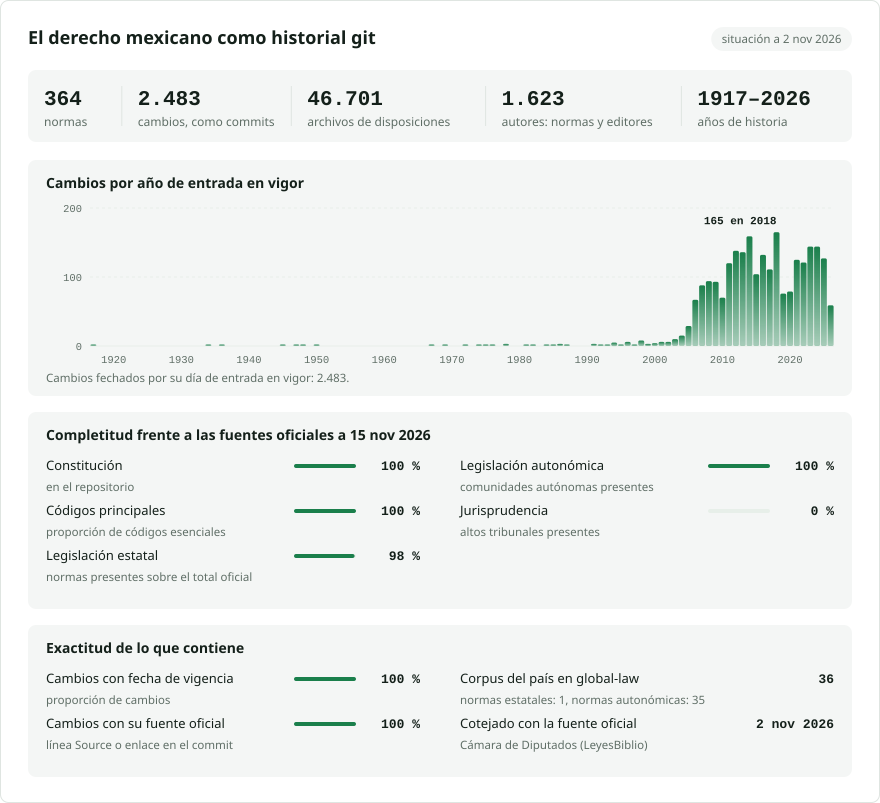

# México: historia del derecho en git

**Español** · [English](README.en.md)

<picture>
<source media="(prefers-color-scheme: dark)" srcset="data/es/effort-dark.svg">

</picture>

El derecho federal de México como historial de git: un archivo por disposición, un commit por decreto, fechado el día de su entrada en vigor, y el decreto que hizo cada cambio como autor del commit. `git blame` nombra el decreto de cada párrafo; `git log` enumera cada cambio de un artículo; al elegir una fecha se obtiene el texto vigente ese día.

Forma parte de [lexifina/global-law](https://github.com/lexifina/global-law), un único historial de git para el derecho de todos los países: este es el derecho federal de México, que global-law lee en `mexico/national/acts/`.

**Qué contiene ahora:** 364 ordenamientos federales con 2,586 versiones: la Constitución (117 versiones, desde el texto vigente el 8 de abril de 2006 hasta la reforma del 7 de octubre de 2026), 10 códigos y 348 leyes, entre ellos el Código Civil Federal, el Código Penal Federal, la Ley Federal del Trabajo y la Ley de Amparo, los reglamentos del Congreso y de cada una de sus Cámaras, el Estatuto de Gobierno del Distrito Federal y la Ordenanza General de la Armada. 56 de los códigos y leyes han sido abrogados desde entonces, o perdieron su vigencia al término del plazo que ellos mismos fijaban, y su historia termina con un commit que elimina todas sus disposiciones. [`data/versions.json`](data/versions.json) enumera cada ordenamiento con el día en que entró en vigor cada versión y la copia de la que se leyó; [`data/laws.csv`](data/laws.csv) enumera cada decreto, sentencia, fe de erratas y demás publicaciones que nombra el registro, con sus fechas.

Cada ordenamiento es una carpeta `<kind>/<year>/<name>/` (`ley/1970/ley-federal-del-trabajo/` es la Ley Federal del Trabajo), con un archivo por artículo (`art-0076.md` es el artículo 76, sobre las vacaciones), uno por los transitorios de cada decreto (`transitorios-<DOF date>.md`) y un `README.md` que enumera cada disposición y cuándo cambió. Hasta el 11 de noviembre de 2026 cada carpeta llevaba solo el id del ordenamiento (`ley-federal-del-trabajo/`), y los 56 ordenamientos cerrados conservan ese nombre; [`data/paths.json`](data/paths.json) relaciona cada id con su carpeta. `git blame` y `git log --follow` siguen el traslado; `git log` de un ordenamiento completo nombra ambas carpetas.

El texto está en español, tal como lo consolida la Cámara de Diputados, un párrafo por línea, sin las notas de la Cámara. Una traducción al inglés no forma parte de este registro.

## Preguntas como comandos de git

| Pregunta | Comando |
| --- | --- |
| Cada cambio del art. 76 de la Ley Federal del Trabajo | `git log --follow -p --word-diff -- ley/1970/ley-federal-del-trabajo/art-0076.md` |
| ¿Qué decreto escribió cada párrafo del art. 76? | `git blame ley/1970/ley-federal-del-trabajo/art-0076.md` |
| Cada versión de la Ley Federal del Trabajo, con el día en que entró en vigor cada una | `git log --format="%h %(trailers:key=In-force,valueonly,separator=) %an" -- ley/1970/ley-federal-del-trabajo ley-federal-del-trabajo ":^*README.md"` |
| El art. 76 vigente el 31 de diciembre de 2022, el día anterior a su reforma | `python tools/en_vigor_el.py 2022-12-31 ley/1970/ley-federal-del-trabajo 76` |

**Fuera de git**, también alojamos este registro de forma pública y gratuita:

- **[Pregunte a Claude sobre el derecho mexicano](https://global-law.lexifina.com/v1/try_claude?country=mexico)**: abre Claude con una primera pregunta ya preparada.
- **[Pregunte a ChatGPT](https://global-law.lexifina.com/v1/try_chatgpt?country=mexico)**: la misma pregunta en ChatGPT.
- **[Busque en el derecho mexicano en nuestro sitio](https://lexifina.com/law?country=mexico&q=vacaciones)**: una búsqueda de "vacaciones", con el texto de cada disposición y sus versiones, sin necesidad de cuenta.
- **[API REST para desarrolladores](https://global-law.lexifina.com/v1/search_law?query=vacaciones&jurisdiction=mexico)**: la misma búsqueda en JSON, sin clave. Consulte la [documentación aquí](https://lexifina.com/api/global-law).

Ambos asistentes leen el registro mediante el conector gratuito Global law (MCP, `https://global-law.lexifina.com/mcp`); la primera vez, el chat le da el enlace para añadirlo. Pregunte en español o en inglés.

**Alójelo usted mismo fácilmente.** Solo hacen falta git y Python, y las herramientas se ejecutan en su propio equipo:

```sh
git clone --depth 1 https://github.com/lexifina/global-law && cd global-law
python3 tools/countries.py add mexico/national/acts
python3 tools/law.py show 2026-01-01 mexico/national/acts/ley/1970/ley-federal-del-trabajo/art-0076.md
```

Abierto en Claude Code, Cursor, VS Code o Codex, el clon también inicia un servidor MCP local con las mismas herramientas ([MCP.md](https://github.com/lexifina/global-law/blob/main/MCP.md)).

## Fechas

Cada commit está fechado al mediodía, hora de America/Mexico_City, del día en que el cambio entró en vigor, y lo lleva en su trailer `In-force:`, junto a `Published:`, el día del Diario Oficial de la Federación (DOF):

- el día se lee de los propios transitorios de cada decreto: "al día siguiente de su publicación" es el día posterior a la publicación, una fecha fija se usa tal como se da, y los plazos en días hábiles, meses o ejercicios fiscales se leyeron decreto por decreto (cada uno se enumera en `REPRODUCE.md`). Cuando no se puede leer ningún transitorio, se aplica el art. 3 del Código Civil Federal: tres días después de la publicación;
- un decreto que pone en vigor disposiciones aisladas en una fecha posterior cambia el artículo completo en su día general, y las fechas posteriores quedan en su archivo de transitorios; la única excepción es el decreto de subcontratación laboral del 23 de abril de 2021, cuyos artículos fiscales y de servicio público toman sus propios días;
- git no puede almacenar fechas anteriores a 1970, por lo que los 10 commits anteriores (el primero es la Ley sobre Delitos de Imprenta, vigente desde el 15 de abril de 1917) llevan fechas a partir del 1970-01-01, con un segundo de diferencia entre ellos, y el día real en `In-force:`. Para consultar una fecha use `tools/en_vigor_el.py`, no `git log --before`.

Cada cambio se atribuye al decreto que lo hizo, con una dirección que no puede existir (`Decreto (DOF 27-12-2022) <decreto-dof-2022-12-27@diputados.invalid>`), solo cuando una de las notas de la Cámara sobre el párrafo ("Párrafo reformado DOF ...") da la fecha de ese decreto. Las sentencias de la Suprema Corte que invalidan disposiciones (40 commits), las fes de erratas y los Acuerdos que actualizan montos son commits propios. Una primera versión que no es el ordenamiento tal como se expidió ("oldest version available", la versión más antigua disponible, 140 ordenamientos) y los 563 cambios que ninguna nota explica se atribuyen al editor, `Cámara de Diputados (LeyesBiblio)`; el committer es Lexifina.

## Cómo se comprueba

- `tools/check_repo.py` vuelve a leer desde git cada versión el día en que entró en vigor y el día anterior; ambas deben coincidir con el corpus, cuyo sha256 está en `data/corpus.sha256`: 2,586 versiones de 364 ordenamientos, 0 discrepancias ([`REPRODUCE.md`](REPRODUCE.md)).
- La última versión de cada ordenamiento es igual a la copia consolidada más reciente disponible de la Cámara; en 362 ordenamientos esa copia, leída de una segunda forma (texto plano, sin notas), también contiene cada párrafo palabra por palabra. Cada versión lleva el sha256 de la copia archivada de la que se leyó.
- Una segunda construcción a partir del mismo corpus dio hashes idénticos (`tools/build.py`).
- El historial solo crece por adición (`tools/append.py`): no hay commits de fusión (merge) en `main`, nada lleva una fecha futura y los trailers de todos los commits se pueden analizar.
- [vulnerabilities/](vulnerabilities/): posibles errores de técnica legislativa en el derecho mexicano, hallados por los detectores de global-law y comprobados a mano.

## Lo que no muestra

- **Todo el derecho federal.** Son 364 ordenamientos: los reglamentos del Ejecutivo, los tratados y la jurisprudencia, más allá de las sentencias de la Suprema Corte que invalidan disposiciones, no están aquí.
- **Los cambios anteriores a la primera versión de un ordenamiento**, que quedan dentro de ese primer commit. La Cámara conserva solo el texto vigente de cada ordenamiento, por lo que 140 ordenamientos empiezan en la copia consolidada más antigua que conservan los archivos (la Constitución en abril de 2006; 89 de los 140 entre 2003 y 2007), y su primer commit nombra los decretos anteriores; los demás empiezan tal como se expidieron.
- **El texto entre dos copias archivadas.** Cuando varios decretos caen entre dos copias, sus cambios se distinguen solo en la medida en que lo permiten las notas de la Cámara; los 563 cambios que ninguna nota explica se atribuyen a la Cámara.
- **Leyes anteriores del mismo nombre.** Cuando una ley sustituyó a otra del mismo nombre (la Ley General de Educación de 1993, la Ley del Impuesto sobre la Renta de 2002 y otras nombradas en `REPRODUCE.md`), la ley anterior no está aquí.
- **Fechas que dependen de un acontecimiento.** Las entradas en vigor graduales por declaratoria (el Código Nacional de Procedimientos Penales y el Código Nacional de Procedimientos Civiles y Familiares) no están en las fechas, y la abrogación de la Ley Federal de Telecomunicaciones y Radiodifusión, que depende de un acontecimiento sin fecha, queda en suspenso.

## Fuentes

| Fuente | Tipo | Versiones anteriores | Notas |
| --- | --- | --- | --- |
| [Leyes Federales Vigentes](https://www.diputados.gob.mx/LeyesBiblio/) (Cámara de Diputados) | Legislación oficial | solo el texto vigente, más cada decreto tal como se publicó | El texto consolidado de cada ordenamiento y su lista de reformas; desde 2013 sus notas nombran los decretos de cada párrafo |
| [Internet Archive Wayback Machine](https://web.archive.org/) | Archivo | sí, por captura | La mayoría de las copias pasadas de los textos de la Cámara, cada una fijada por su captura; unas pocas proceden de otros archivos web, nombrados en `REPRODUCE.md` |

## Licencia

Véase [`LICENSE`](LICENSE). Los textos jurídicos son textos oficiales de los Estados Unidos Mexicanos, reproducidos con la atribución "Fuente: Cámara de Diputados del H. Congreso de la Unión, Secretaría General, Secretaría de Servicios Parlamentarios, Leyes Federales Vigentes (www.diputados.gob.mx/LeyesBiblio)"; la Cámara no publica una licencia aparte para ellos, y la Ley Federal del Derecho de Autor, art. 14, fracción VIII, excluye los textos legislativos de la protección del derecho de autor. Las aportaciones propias de Lexifina (la ordenación, los mensajes de commit, las tablas y las herramientas) son CC0 1.0.

Ningún modelo de IA escribió, tradujo ni corrigió texto jurídico, y ninguno se ejecuta al construir el historial; los scripts los escribió Claude Code con Claude Opus 5.5 (véase [`REPRODUCE.md`](REPRODUCE.md)).

Esta es una traducción de la versión inglesa ([README.en.md](README.en.md)); si difieren, prevalece la versión inglesa.

## Visualizaciones

- [visualisations/](visualisations/): gráficos hechos a partir de este repositorio. Aún no se han hecho.

## Más información

Del repositorio [lexifina/global-law](https://github.com/lexifina/global-law) (páginas en inglés):

- [FEATURES.md](https://github.com/lexifina/global-law/blob/main/FEATURES.md): todas las funciones y lo que cada corpus debe admitir (`git blame`, `law.py`, herramientas MCP)
- [FAQ.md](https://github.com/lexifina/global-law/blob/main/FAQ.md): preguntas y respuestas · [CONTRIBUTING.md](https://github.com/lexifina/global-law/blob/main/CONTRIBUTING.md): proponer cambios · [MCP.md](https://github.com/lexifina/global-law/blob/main/MCP.md): servidor MCP · [REPRODUCE.md](https://github.com/lexifina/global-law/blob/main/REPRODUCE.md): cómo se ha construido · [CHANGELOG.md](https://github.com/lexifina/global-law/blob/main/CHANGELOG.md)
- [FRESHNESS.md](https://github.com/lexifina/global-law/blob/main/FRESHNESS.md): lo actualizado que está cada corpus · [Supervisión](https://github.com/lexifina/global-law/tree/main/monitoring): si las actualizaciones funcionan · [WATCHING.md](https://github.com/lexifina/global-law/blob/main/WATCHING.md): cómo se vigila cada fuente oficial para detectar cambios
- [performance/](https://github.com/lexifina/global-law/tree/main/performance): la rapidez de las herramientas, medida
- [visualisations/](https://github.com/lexifina/global-law/tree/main/visualisations): gráficos y conexiones a través del derecho de todo el mundo
- [Vulnerabilidades](https://github.com/lexifina/global-law/tree/main/vulnerabilities): errores en las normas tal como se publicaron
