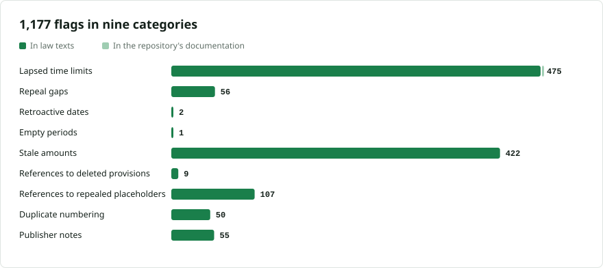

# Vulnerabilities in Mexican law

[Español](README.md) · **English**

<picture>
<source media="(prefers-color-scheme: dark)" srcset="img/flags-by-category-dark.svg">

</picture>

The vulnerability detectors from [lexifina/global-law](https://github.com/lexifina/global-law/tree/main/vulnerabilities) look for mechanical mistakes in legislation: a rule applying "until" a date that has passed, a time limit extended only after it had run out, a provision repealed before its replacement took effect, an amount changed in one place but not in another, a reference to an article that no longer exists. global-law's published list (9 November 2026) covered Mexico with 3 flags from an earlier copy of this repository: three lapsed time limits in transitional articles of the Constitution, which its review judged lawful (2) or artefacts (1). This is a run over this repository only, as it stood at commit [`2d273ee`](https://github.com/lexifina/mexico-law/commit/2d273eeb066e1661d35f8b901df2ba642b3dc37e) on 16 November 2026, with its whole history and with the Supreme Court rulings that invalidated provisions counted as changes in the law.

**In short:** the detectors raised 1,177 flags. A language model reviewed 132 of the strongest, arguing each one for and against; 13 survived. Checked by hand in this repository, one of them looks like a real oversight in Mexican law, though with no practical effect: Article Three of the transitional provisions of the decree that enacted the Law Regulating the Activities of Savings and Loan Cooperatives (DOF 13-08-2009) gave cooperatives with assets above 2,500,000 UDIS that took deposits from their members without having applied for authorisation "until 31 December 2012" to become savings and loan cooperatives and apply to the National Banking and Securities Commission; the decree published on 4 January 2013 moved the limit to 31 March 2014 only from the day after its publication, with no retroactive wording, so from 1 to 4 January 2013 the time limit had run out. Among the flags that did not survive, reading by hand found another: the last paragraph of Article 26 of the General Law on Social Communication, amended by a decree published on 2 June 2023, refers to "the principles set out in Article 5 Bis of this Law", an article the Supreme Court invalidated, with the whole decree of 27 December 2022 that added it, with effect from 8 May 2023. Of the other 12, 10 come from how this repository files decrees, agreements and rulings (each with its whole text in a transitional-provisions file) and 2 are spent transitional rules. The model does not review three categories; reading them turned up no further mistake, but a build problem of this repository, described below. Later, this will be formalised in Lean, similar to our work on [the US tax code](https://lexifina.com/blog/formalizing-the-us-tax-code) and [US case law](https://lexifina.com/blog/formalizing-all-us-case-law-in-lean).

A flag is a prompt to look, not legal advice, and nothing here has been tested in court.

## Flags by category

| Category | What it looks for | Flags | In law texts | Reviewed | Survived review |
| --- | --- | ---: | ---: | ---: | ---: |
| Lapsed time limits | Text still applying a rule "until" a date that has passed | 475 | 474 | 40 | 2 |
| Repeal gaps | A provision removed before its replacement took effect | 56 | 56 | 40 | 0 |
| Retroactive or pre-publication dates | A rule in force before its publication in the Diario Oficial de la Federación | 2 | 2 | 2 | 0 |
| Empty periods | A time limit extended by an act that took effect after it had run out | 1 | 1 | 1 | 1 |
| Stale amounts | An amount changed in one place but still standing elsewhere | 422 | 422 | 40 | 8 |
| References to deleted provisions | A provision citing an article that no longer exists | 9 | 9 | 9 | 2 |
| References to repealed placeholders | A provision citing an article that now reads only "Se deroga" or "Derogado" | 107 | 107 | 0 | 0 |
| Duplicate numbering | Two units with the same number in one act | 50 | 50 | 0 | 0 |
| Publisher notes | The Cámara de Diputados' "(sic)" and similar notes | 55 | 55 | 0 | 0 |

"In law texts" counts every file of the acts (`constitucion/`, `codigo/`, `ley/`, `estatuto/`, `ordenanza/`, `reglamento/`): their articles and each decree's transitional provisions, which here hold the whole text of the decree, agreement or ruling as published. The other flag is in [`README.en.md`](../README.en.md). Of the 475 lapsed time limits, 461 are in transitional-provisions files and 232 are deadlines ("a más tardar", no later than); 177 are copies of the same passage, because a decree that amends several acts is filed with its transitional provisions in the folder of each (the decree on labour subcontracting of 23 April 2021, filed in eight, gives 40 alone). In transitional provisions the search measures dates that passed while the provision stayed unchanged: transitional regimes that ended as written, and deadlines for Congress or the authorities to legislate, issue regulations or adapt. It does not say whether those deadlines were met, nor does it point to a gap by itself. It does not read relative deadlines ("dentro de los 180 días siguientes a la entrada en vigor del presente Decreto", within 180 days of the decree taking effect; there are about 1,600 in 673 transitional-provisions files), nor phrases that give only a year ("hasta el ejercicio fiscal 2020", "hasta el año 2020": 37, of them 34 past). The search for publisher notes now also reads the note with which the Cámara marks a slip in the published text and the DOF issue that carried it, "(sic DOF 03-02-1983)": 6 flags became 55. The search for dead currencies found nothing, rightly: the peso is the currency in use. Amounts in national currency in laws that took effect before 1 January 1993 are read as the monetary unit that the decree of 22 June 1992 replaced with the new peso, and are computed or paid at the equivalence of its Article 1 (Article Nine of the decree's transitional provisions, in the Ley Monetaria's folder). This repository holds such amounts, such as the oral gift of movables "worth no more than two hundred pesos" (Article 2343 of the Federal Civil Code, unchanged since its oldest copy, of 2005); they are amounts that lost their value, not dead currencies, and only the date they were written tells them from current ones, so they are not flagged. Sums in "nuevos pesos" in the tax laws are read as pesos from 1 January 1996 (Article Two of the transitional provisions of the tax decrees published on 15 December 1995). A repealed article keeps its file here, reading only "Se deroga" or "Derogado", so a reference to it counts as a reference to a repealed placeholder; the search for dead fines found nothing. Nor did the search for same-day conflicts: the 140 commits that gather the changes of several decrees that took effect on the same day credit them to the later one (`Also-amended-by:`), and the search compares commits.

*Edge cases: the 13 flags that survived the review, grouped by what they turned out to be, and what the other flags are, in [EDGE-CASES.en.md](EDGE-CASES.en.md).*

## Problems found in this repository

- **Articles without a file of their own:** where splitting the text does not recognise an article's number, the article stays inside the previous one's file. 1,017 articles in 32 files of 13 acts read this way: Articles 1,000 to 1,289 and 1,291 to 1,868 of the Ordenanza General de la Armada (naval ordinance), numbered with a comma, are in the files of Articles [999](https://github.com/lexifina/mexico-law/blob/2d273eeb066e1661d35f8b901df2ba642b3dc37e/ordenanza/2000/ordenanza-general-de-la-armada/art-0999.md) and [1290](https://github.com/lexifina/mexico-law/blob/2d273eeb066e1661d35f8b901df2ba642b3dc37e/ordenanza/2000/ordenanza-general-de-la-armada/art-1290.md) (868); 88 articles of the Ley Federal de Derechos (Federal Duties Act) with a second suffix ("31-A-1", ["195-Z-1" to "195-Z-36"](https://github.com/lexifina/mexico-law/blob/2d273eeb066e1661d35f8b901df2ba642b3dc37e/ley/1981/ley-federal-de-derechos/art-195-z.md)), in 19 files; Articles 58-1 to 58-29 of the Ley Federal de Procedimiento Contencioso Administrativo (the summary procedure), in that of [58-S](https://github.com/lexifina/mexico-law/blob/2d273eeb066e1661d35f8b901df2ba642b3dc37e/ley/2005/ley-federal-de-procedimiento-contencioso-administrativo/art-058-s.md); Latin ordinals after "Decies" or "Octavus" ("Undecies", "Duodecies", "Novenus", "Sexíes", "Quintes") in the Civil Aviation Act (9), the Airports Act (8), the General Law on Women's Access to a Life Free of Violence (4), the General Law on Disappearances (2) and four others; Articles 56 Bis to 56 Quinquies of the Senate Rules, with no punctuation after the number (4), and Article 26-LL of the Special Tax on Production and Services Act. They have no history of their own in `git log` or `git blame`, are not listed in their act's `README.md`, and tools that look an article up by its number do not find them. In the same way, in five acts a decree's transitional provisions stayed in the file of the last article: those of the 1931 Ley Monetaria in [Article 23](https://github.com/lexifina/mexico-law/blob/2d273eeb066e1661d35f8b901df2ba642b3dc37e/ley/1931/ley-monetaria/art-023.md) and those of the 2009 decree in [Article 132](https://github.com/lexifina/mexico-law/blob/2d273eeb066e1661d35f8b901df2ba642b3dc37e/ley/2009/ley-de-cooperativas-de-ahorro-y-prestamo/art-132.md) of the Law Regulating the Activities of Savings and Loan Cooperatives, among them. 26 duplicate-numbering flags come from these files.
- **Rulings dated by their publication, not their effect:** the record dates each Supreme Court ruling on the day it was published in the DOF. 18 of the 40 ruling commits give in their own message an earlier "notificación para efectos legales" (notification with legal effect), from 16 days to almost three years before (Action of Unconstitutionality 130/2019 was notified on 25 November 2022 and published on 20 August 2025). Where a ruling takes effect on notification, as the two that were read say of themselves, the record meanwhile shows the invalidated text as in force: Action of Unconstitutionality 82/2021, which invalidated the National Register of Mobile Telephone Users (Articles 180 Bis to 180 Septimus of the Federal Telecommunications and Broadcasting Law, among others), gives its notification as 27 April 2022, and the record marks the invalidated text from 12 December 2022 ([the change](https://github.com/lexifina/mexico-law/commit/aebf3e21283a21a0f90832f7d9237be57f29a01f)); the reversal of the General Law on Social Communication, invalidated with effect from 8 May 2023, appears on 3 June as a change no note explains ([the change](https://github.com/lexifina/mexico-law/commit/239f244992ff25dc0575512e6fe6f86b8a8edca6)).

## Files

| File | What it holds |
| --- | --- |
| [data/flags.csv](data/flags.csv) | Every flag, one row per provision and issue |
| [data/reviewed.csv](data/reviewed.csv) | The 132 flags the model reviewed, with its verdict and reason |
| [data/by_category.csv](data/by_category.csv) | The counts in the table above |
| [tools/](tools/) | The scripts that made this run |

Columns: `category` and `category_es` (the category in English and Spanish), `detector`, `kind` (`law` or `other`), `path` (the file in this repository; for a retroactive date, the act's first file), `date` (the date the flag turns on), `reference` (the decree or line involved), `summary`, `score` (the detector's ranking, 0 to 1), `review` (`artefact`, `lawful` or `candidate_defect`), `survives_rebuttal`, `review_note` (the model's reason, in English), `url` (the provision at the commit that was read or, if it was removed before, at the last commit that held it).

## How it was made

- **Detectors:** global-law's [vulnerabilities/scripts](https://github.com/lexifina/global-law/tree/main/vulnerabilities/scripts), run on this repository at commit `2d273ee`. global-law replays this repository only up to an earlier commit, so the history table the detectors read was built from this repository's own commits (the decree, agreement or ruling that made each change, its `In-force` date and its `Kind`; decrees, oldest available versions and Supreme Court rulings count as law, and documentation is left out), with paths from before the move of folders on 11 November 2026 mapped to each act's folder today. The detectors carry the fixes global-law's scripts received in the runs on other country repositories, among them the date forms of Spanish as written in Spain and Colombia ("hasta el día 31 de diciembre de 2020", "1o. de enero", "a más tardar el ..."), and one for Mexico: the "(sic DOF ...)" note above.
- **Model review:** gpt-5.4-mini, the 40 strongest flags per category (all of them, in the smaller categories); one pass says whether a flag is real, a second argues that it is not. Empty periods use global-law's own review for that category, on the one flag, followed by the same second pass. The model does not review references to repealed placeholders, duplicate numbering or publisher notes. global-law's own list used a different model.
- **Hand check:** every flag that survived was read in this repository's history and texts, and in the extending, updating or invalidating decree, agreement or ruling, which this repository holds in its transitional-provisions files. All nine references to deleted provisions were also read, as were the publisher notes, the duplicate numbers, the references to repealed placeholders outside transitional provisions and a sample of the rest. The articles without a file of their own were counted with `merged_articles.py` (in [tools/](tools/)).

To report a correction, open an issue with the provision and an official source.

## Licence

The lists and notes are Lexifina's, dedicated to the public domain under CC0 1.0, like this repository's other own contributions. Quoted law text is official text of the United Mexican States as consolidated by the Cámara de Diputados: "Fuente: Cámara de Diputados del H. Congreso de la Unión, Secretaría General, Secretaría de Servicios Parlamentarios, Leyes Federales Vigentes (www.diputados.gob.mx/LeyesBiblio)"; the Ley Federal del Derecho de Autor, art. 14, fracción VIII, excludes legislative texts from copyright protection. The Cámara de Diputados does not endorse this repository. See [LICENSE](../LICENSE).
