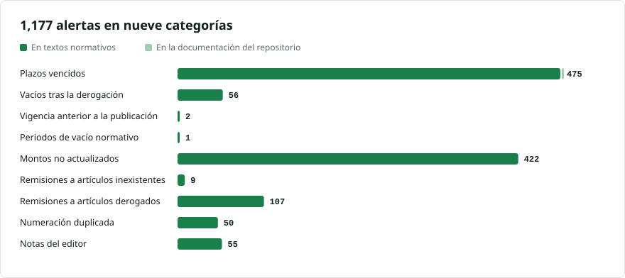

# Vulnerabilidades en el derecho mexicano

**Español** · [English](README.en.md)

<picture>
<source media="(prefers-color-scheme: dark)" srcset="img/flags-by-category-dark.es.svg">

</picture>

Los detectores de vulnerabilidades de [lexifina/global-law](https://github.com/lexifina/global-law/tree/main/vulnerabilities) buscan errores mecánicos en la legislación: una regla que sigue aplicándose «hasta» una fecha ya pasada, un plazo prorrogado cuando ya había vencido, una disposición derogada antes de que rigiera la que la sustituye, un monto modificado en un lugar pero no en otro, una remisión a un artículo que ya no existe. La lista que global-law publicó el 9 de noviembre de 2026 incluía México con 3 alertas, obtenidas de una copia anterior de este repositorio: tres plazos vencidos en artículos transitorios de la Constitución, que su revisión dio por conformes a derecho (2) o por artefactos (1). Esta es una revisión de este repositorio solamente, en el estado del commit [`2d273ee`](https://github.com/lexifina/mexico-law/commit/2d273eeb066e1661d35f8b901df2ba642b3dc37e) de 16 de noviembre de 2026, con toda su historia y con las sentencias de la Suprema Corte que invalidaron disposiciones contadas como cambios del derecho.

**En resumen:** los detectores generaron 1,177 alertas. Un modelo de lenguaje revisó las 132 más sólidas, con argumentos a favor y en contra de cada una; 13 resistieron. Comprobada a mano en este repositorio, una de ellas parece un descuido real del derecho mexicano, aunque de efecto práctico nulo: el artículo tercero transitorio del decreto por el que se expidió la Ley para Regular las Actividades de las Sociedades Cooperativas de Ahorro y Préstamo (DOF 13-08-2009) daba a las cooperativas con activos superiores a 2'500,000 UDIS que captaban recursos de sus socios sin haber solicitado autorización «hasta el 31 de diciembre de 2012» para constituirse como sociedades cooperativas de ahorro y préstamo y solicitar la autorización de la Comisión Nacional Bancaria y de Valores; el decreto publicado el 4 de enero de 2013 llevó el plazo al 31 de marzo de 2014 solo desde el día siguiente a su publicación, sin efectos retroactivos, de modo que del 1 al 4 de enero de 2013 el plazo estuvo vencido. Entre las alertas que no resistieron, la lectura a mano halló otra: el párrafo último del artículo 26 de la Ley General de Comunicación Social, reformado por decreto publicado el 2 de junio de 2023, ordena atender «los principios previstos en el artículo 5 Bis de esta Ley», artículo que la Suprema Corte invalidó, con todo el decreto de 27 de diciembre de 2022 que lo adicionó, con efectos desde el 8 de mayo de 2023. De las otras 12, 10 se explican por cómo este repositorio archiva los decretos, los acuerdos y las sentencias (cada uno con su texto íntegro en un archivo de transitorios) y 2 son reglas transitorias agotadas. El modelo no revisa tres categorías; su lectura no arrojó ningún error más, pero sí un problema de construcción del repositorio que se describe más abajo. Más adelante se formalizará en Lean, como nuestro trabajo sobre [el código tributario de EE. UU.](https://lexifina.com/blog/formalizing-the-us-tax-code) y [la jurisprudencia de EE. UU.](https://lexifina.com/blog/formalizing-all-us-case-law-in-lean).

Una alerta es una invitación a examinar el texto, no una asesoría jurídica, y nada de lo aquí expuesto se ha sometido a un tribunal.

## Alertas por categoría

| Categoría | Qué busca | Alertas | En textos normativos | Revisadas | Resistieron la revisión |
| --- | --- | ---: | ---: | ---: | ---: |
| Plazos vencidos | Un texto que sigue aplicando una regla «hasta» una fecha ya pasada | 475 | 474 | 40 | 2 |
| Vacíos tras la derogación | Una disposición retirada antes de que rigiera la que la sustituye | 56 | 56 | 40 | 0 |
| Vigencia anterior a la publicación | Una regla en vigor antes de su publicación en el Diario Oficial de la Federación | 2 | 2 | 2 | 0 |
| Periodos de vacío normativo | Un plazo prorrogado por una norma que entró en vigor cuando ya había vencido | 1 | 1 | 1 | 1 |
| Montos no actualizados | Un monto modificado en un lugar que sigue figurando en otro | 422 | 422 | 40 | 8 |
| Remisiones a disposiciones inexistentes | Una disposición que remite a un artículo que ya no existe | 9 | 9 | 9 | 2 |
| Remisiones a disposiciones derogadas | Una disposición que remite a un artículo que solo dice «Se deroga» o «Derogado» | 107 | 107 | 0 | 0 |
| Numeración duplicada | Dos divisiones con el mismo número en un ordenamiento | 50 | 50 | 0 | 0 |
| Notas del editor | Los «(sic)» de la Cámara de Diputados y notas semejantes | 55 | 55 | 0 | 0 |

«En textos normativos» cuenta todos los archivos de los ordenamientos (`constitucion/`, `codigo/`, `ley/`, `estatuto/`, `ordenanza/`, `reglamento/`): sus artículos y los transitorios de cada decreto, que aquí guardan el texto íntegro del decreto, del acuerdo o de la sentencia tal como se publicó. La otra alerta está en [`README.en.md`](../README.en.md). De los 475 plazos vencidos, 461 están en archivos de transitorios y 232 son plazos «a más tardar»; 177 son copias de un mismo pasaje, porque un decreto que reforma varios ordenamientos se archiva con sus transitorios en la carpeta de cada uno (solo el decreto de subcontratación laboral de 23 de abril de 2021, archivado en ocho, da 40). En los transitorios, la búsqueda mide fechas que ya pasaron sin que la disposición cambiara: regímenes transitorios que terminaron como estaba previsto y plazos para que el Congreso o las autoridades legislaran, reglamentaran o se adecuaran. No dice si esos plazos se cumplieron, ni señala por sí un vacío. No lee los plazos relativos («dentro de los 180 días siguientes a la entrada en vigor del presente Decreto»; hay unos 1,600 en 673 archivos de transitorios), ni las expresiones que solo indican un año («hasta el ejercicio fiscal 2020», «hasta el año 2020»: 37, de ellas 34 ya pasadas). La búsqueda de notas del editor lee ahora también la nota con que la Cámara señala un desliz del texto publicado y el DOF que lo trajo, «(sic DOF 03-02-1983)»: las 6 alertas pasaron a 55. La de monedas sin curso legal no halló nada, y con razón: el peso es la moneda en curso. Las cantidades en moneda nacional de las leyes que entraron en vigor antes del 1o. de enero de 1993 se entienden referidas a la unidad monetaria que el decreto de 22 de junio de 1992 sustituyó por el nuevo peso, y al computarlas o pagarlas se aplica la equivalencia de su artículo 1o. (artículo noveno transitorio del decreto, en la carpeta de la Ley Monetaria). Este repositorio guarda montos así, como la donación verbal de muebles que «no pase de doscientos pesos» (artículo 2343 del Código Civil Federal, sin cambios desde su copia más antigua, de 2005); son montos que perdieron su valor, no monedas extinguidas, y solo la fecha en que se escribieron los distingue de los actuales, de modo que no se señalan. Las sumas en «nuevos pesos» de las leyes fiscales se entienden como pesos desde el 1o. de enero de 1996 (artículo segundo transitorio de los decretos fiscales publicados el 15 de diciembre de 1995). Un artículo derogado conserva aquí su archivo, que solo dice «Se deroga» o «Derogado», de modo que una remisión a él cuenta como remisión a una disposición derogada; la búsqueda de sanciones sin conducta tipificada no halló nada. Tampoco la de reformas del mismo día: los 140 commits que reúnen los cambios de varios decretos que entraron en vigor el mismo día los atribuyen al último (`Also-amended-by:`), y la búsqueda compara commits.

*Casos límite: las 13 alertas que resistieron la revisión, agrupadas según lo que resultaron ser, y qué son las demás alertas, en [EDGE-CASES.md](EDGE-CASES.md).*

## Problemas detectados en este repositorio

- **Artículos sin archivo propio:** cuando la división del texto no reconoce la numeración de un artículo, este queda dentro del archivo del anterior. Así ocurre con 1,017 artículos en 32 archivos de 13 ordenamientos: los artículos 1,000 a 1,289 y 1,291 a 1,868 de la Ordenanza General de la Armada, numerados con coma, están en los archivos de los artículos [999](https://github.com/lexifina/mexico-law/blob/2d273eeb066e1661d35f8b901df2ba642b3dc37e/ordenanza/2000/ordenanza-general-de-la-armada/art-0999.md) y [1290](https://github.com/lexifina/mexico-law/blob/2d273eeb066e1661d35f8b901df2ba642b3dc37e/ordenanza/2000/ordenanza-general-de-la-armada/art-1290.md) (868); 88 artículos de la Ley Federal de Derechos con un segundo sufijo («31-A-1», [«195-Z-1» a «195-Z-36»](https://github.com/lexifina/mexico-law/blob/2d273eeb066e1661d35f8b901df2ba642b3dc37e/ley/1981/ley-federal-de-derechos/art-195-z.md)), en 19 archivos; los artículos 58-1 a 58-29 de la Ley Federal de Procedimiento Contencioso Administrativo (el juicio en la vía sumaria), en el del [58-S](https://github.com/lexifina/mexico-law/blob/2d273eeb066e1661d35f8b901df2ba642b3dc37e/ley/2005/ley-federal-de-procedimiento-contencioso-administrativo/art-058-s.md); los ordinales latinos posteriores a «Decies» u «Octavus» («Undecies», «Duodecies», «Novenus», «Sexíes», «Quintes») en las Leyes de Aviación Civil (9), de Aeropuertos (8), General de Acceso de las Mujeres a una Vida Libre de Violencia (4), General en Materia de Desaparición (2) y otras cuatro; los artículos 56 Bis a 56 Quinquies del Reglamento del Senado, sin puntuación tras el número (4), y el 26-LL de la Ley del Impuesto Especial sobre Producción y Servicios. No tienen historia propia en `git log` ni `git blame`, ni figuran en el `README.md` de su ordenamiento, y las herramientas que buscan un artículo por su número no los encuentran. De la misma manera, en cinco ordenamientos los transitorios de un decreto quedaron en el archivo del último artículo: los de la Ley Monetaria de 1931 en el [artículo 23](https://github.com/lexifina/mexico-law/blob/2d273eeb066e1661d35f8b901df2ba642b3dc37e/ley/1931/ley-monetaria/art-023.md) y los del decreto de 2009 en el [artículo 132](https://github.com/lexifina/mexico-law/blob/2d273eeb066e1661d35f8b901df2ba642b3dc37e/ley/2009/ley-de-cooperativas-de-ahorro-y-prestamo/art-132.md) de la Ley para Regular las Actividades de las Sociedades Cooperativas de Ahorro y Préstamo, entre ellos. 26 alertas de numeración duplicada vienen de esos archivos.
- **Sentencias fechadas por su publicación y no por sus efectos:** el registro fecha cada sentencia de la Suprema Corte el día de su publicación en el DOF. 18 de los 40 commits de sentencias consignan en su propio mensaje una «notificación para efectos legales» anterior, de 16 días a casi tres años antes (la Acción de Inconstitucionalidad 130/2019 se notificó el 25 de noviembre de 2022 y se publicó el 20 de agosto de 2025). Cuando la sentencia surte efectos desde la notificación, como dicen de sí mismas las dos que se leyeron, el registro muestra entretanto el texto invalidado como vigente: la Acción de Inconstitucionalidad 82/2021, que invalidó el Padrón Nacional de Usuarios de Telefonía Móvil (artículos 180 Bis a 180 Septimus de la Ley Federal de Telecomunicaciones y Radiodifusión, entre otros), consigna su notificación el 27 de abril de 2022, y el registro marca el texto invalidado desde el 12 de diciembre de 2022 ([el cambio](https://github.com/lexifina/mexico-law/commit/aebf3e21283a21a0f90832f7d9237be57f29a01f)); la reversión de la Ley General de Comunicación Social, invalidada con efectos desde el 8 de mayo de 2023, figura el 3 de junio como un cambio que ninguna nota explica ([el cambio](https://github.com/lexifina/mexico-law/commit/239f244992ff25dc0575512e6fe6f86b8a8edca6)).

## Archivos

| Archivo | Contenido |
| --- | --- |
| [data/flags.csv](data/flags.csv) | Todas las alertas, una fila por disposición y problema |
| [data/reviewed.csv](data/reviewed.csv) | Las 132 alertas que revisó el modelo, con su veredicto y su motivo |
| [data/by_category.csv](data/by_category.csv) | Las cifras de la tabla anterior |
| [tools/](tools/) | Los scripts de esta revisión |

Columnas: `category` y `category_es` (la categoría en inglés y en español), `detector`, `kind` (`law` u `other`), `path` (el archivo en este repositorio; en la vigencia anterior a la publicación, el primer archivo del ordenamiento), `date` (la fecha de la que depende la alerta), `reference` (el decreto o la línea afectada), `summary`, `score` (la puntuación del detector, de 0 a 1), `review` (`artefact`, `lawful` o `candidate_defect`), `survives_rebuttal`, `review_note` (el motivo del modelo, en inglés), `url` (la disposición en el commit leído o, si se suprimió antes, en el último commit que la contenía).

## Cómo se hizo

- **Detectores:** los [vulnerabilities/scripts](https://github.com/lexifina/global-law/tree/main/vulnerabilities/scripts) de global-law, ejecutados sobre este repositorio en el commit `2d273ee`. global-law reproduce este repositorio solo hasta un commit anterior, por lo que la tabla histórica que leen los detectores se construyó con los propios commits de este repositorio (el decreto, el acuerdo o la sentencia que hizo cada cambio, su fecha `In-force` y su `Kind`; los decretos, las versiones más antiguas disponibles y las sentencias de la Suprema Corte cuentan como derecho, y se excluye la documentación), con las rutas anteriores al traslado de carpetas de 11 de noviembre de 2026 llevadas a la carpeta actual de cada ordenamiento. Los detectores incorporan las correcciones que los scripts de global-law recibieron en las revisiones de otros repositorios nacionales, entre ellas las formas de fecha del español de España y de Colombia («hasta el día 31 de diciembre de 2020», «1o. de enero», «a más tardar el ...»), y una para México: la nota «(sic DOF ...)» indicada arriba.
- **Revisión por el modelo:** gpt-5.4-mini, las 40 alertas más sólidas de cada categoría (todas, en las categorías con menos); una pasada dice si la alerta es real y otra argumenta que no lo es. Los periodos de vacío normativo usan la revisión propia de global-law para esa categoría, sobre la única alerta, seguida de la misma segunda pasada. El modelo no revisa las remisiones a disposiciones derogadas, la numeración duplicada ni las notas del editor. La lista propia de global-law usó otro modelo.
- **Comprobación manual:** cada alerta que resistió se leyó en la historia y los textos de este repositorio, y en el decreto, el acuerdo o la sentencia que prorroga, actualiza o invalida, que este repositorio contiene en sus archivos de transitorios. Se leyeron también las nueve remisiones a disposiciones inexistentes, las notas del editor, la numeración duplicada y las remisiones a disposiciones derogadas fuera de los transitorios, y una muestra de las demás. Los artículos sin archivo propio se contaron con `merged_articles.py` (en [tools/](tools/)).

Para comunicar una corrección, abra una incidencia con la disposición y una fuente oficial.

## Licencia

Las listas y las notas son de Lexifina y se dedican al dominio público con CC0 1.0, como las demás aportaciones propias de este repositorio. El texto jurídico citado es texto oficial de los Estados Unidos Mexicanos, tal como lo consolida la Cámara de Diputados: «Fuente: Cámara de Diputados del H. Congreso de la Unión, Secretaría General, Secretaría de Servicios Parlamentarios, Leyes Federales Vigentes (www.diputados.gob.mx/LeyesBiblio)»; la Ley Federal del Derecho de Autor, art. 14, fracción VIII, excluye los textos legislativos de la protección del derecho de autor. La Cámara de Diputados no avala este repositorio. Véase [LICENSE](../LICENSE).
